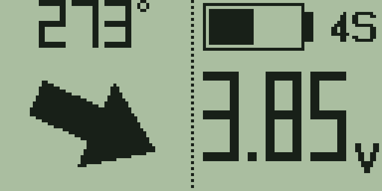
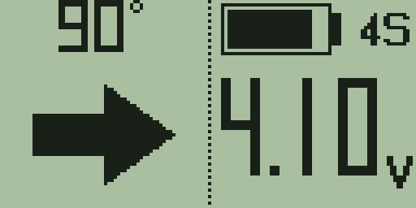
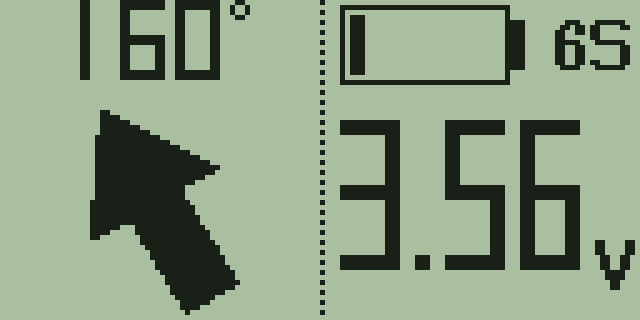
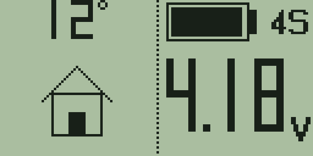
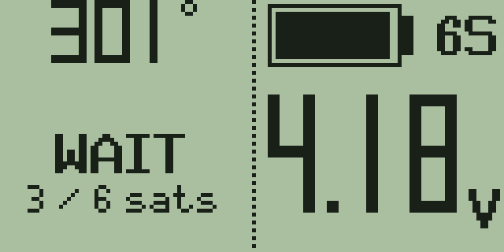
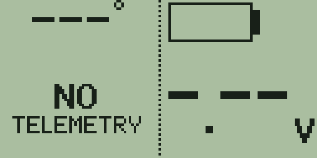

# EdgeTX

### Telemetry screen:

#### HomePoint – EdgeTX telemetry screen for RadioMaster Pocket

A full-screen telemetry page for 128x64 black-and-white EdgeTX radios
(RadioMaster Pocket, also Zorro, Boxer, TX12, MT12 and similar).

- **Left:** a big arrow that points to the home point, meaning the spot where
  you armed and took off. It works like the home arrow in a Betaflight or INAV
  OSD:
  - straight up means home is dead ahead of the nose, so you are flying back
    towards it;
  - straight down means home is behind you.

  The craft heading in degrees sits above it.
- **Right:** a battery icon and the **average cell voltage**. The pack's cell
  count is detected for you, so 4S and 6S packs both read 4.20 V down to 3.50 V.
  The detected count (`4S`, `6S`…) is shown next to the icon.

| Low 6S pack (icon blinks at ≤ 3.50 V) | At home | Waiting for GPS | No telemetry |
|---|---|---|---|
|  |  |  |  |

The screenshots come from the desktop simulator in `tools/`. It draws pixels
the same way the radio does: the font bitmaps and drawing code were ported
from the EdgeTX source.

**Install**

1. Copy `SCRIPTS/TELEMETRY/homept.lua` to `/SCRIPTS/TELEMETRY/` on the radio's SD card.
2. On the radio: **Model** -> Telemetry**, then scroll to **Screens**. Set a screen
   (for example *Screen 1*) to **Script** and pick **homept**.
3. Run **Discover new sensors** once with the model powered, so EdgeTX knows
   the sensors.
4. From the main screen, press **TELE** to open the page. **PAGE** switches
   between telemetry screens.

EdgeTX limits telemetry script names to 6 characters, so the file is named `homept`.

**Using it**

| What you see | Meaning |
|---|---|
| Arrow | Turn towards the arrow to fly home. Straight up means home is dead ahead. |
| House | You are within 10 m of home. Close in, GPS noise would make the arrow spin. |
| `WAIT 3 / 6 sats` | Home is not locked yet. It locks once the FC reports at least 6 satellites. |
| `NO GPS` | No GPS position is coming in yet, or the model has no GPS sensor. |
| `NO HDG` | Neither a `Yaw` nor an `Hdg` sensor exists. |
| `NO TELEMETRY` | The link is down. Voltage and heading show dashes. |
| Blinking battery | The average cell voltage is at or below 3.50 V. |

**ENTER** (short press) re-locks home at your current position and counts the
cells again, with a short beep. A long ENTER press still opens EdgeTX's own
*Reset telemetry* menu.

**How home is set**

- When the GPS first reports enough satellites, that position becomes home.
- When you **arm**, home moves to the spot where you armed, as long as the GPS
  has a good fix at that moment. Arming is read from the `FM` flight-mode
  sensor:
  - Betaflight adds `*`, `!` or `?` to the mode name while disarmed.
  - INAV reports `OK`, `WAIT` or `!ERR` while disarmed.
- If you lose the link in flight, home is kept.

Neither Betaflight nor INAV sends the OSD's home direction or distance over
CRSF telemetry. They send only GPS position, ground course, speed, altitude,
satellites, attitude, battery and flight mode. So the script does the same sum
the flight controller does for its OSD:

> arrow angle = bearing from the craft to home − heading (`Yaw`)

Home is the position at arming, and heading comes from the attitude `Yaw`. As
on the FC, this means the arrow follows the nose, not the direction of travel.

**How the cell count is detected**

- **Cell count** = pack voltage ÷ 4.3, rounded up. For example, 16.8 V means
  4S, and 22.8 V means 6S.
- The count is taken only while disarmed, when the pack is at rest. It only
  ever goes up, never down. While armed it is frozen, so voltage sag under load
  can't make a 6S look like a 5S.
- Unplugging the pack on the bench (no link for 5 s while disarmed) resets the
  count for the next pack. A failsafe in flight does not reset it.
- If an FLVSS-style `Cels` sensor exists, its real per-cell values are used
  instead of the calculation above.
- Without an `FM` sensor the script can't tell a pack swap from a failsafe, so
  the count is never reset on its own. Press ENTER after changing to a smaller
  pack.

**Sensors used**

If several sensors in a row exist, the first one found is used.

| Purpose | Sensors | Notes |
|---|---|---|
| Position | `GPS` | |
| Satellites | `Sats` | optional; used to gate home lock |
| Heading | `Yaw`, then `Hdg` | CRSF `Yaw` comes in radians and is converted |
| Battery | `Cels`, `VFAS`, `RxBt`, `A4` | |
| Arming | `FM` | optional |

With ExpressLRS/Crossfire and Betaflight or INAV, all of these come over CRSF
without any setup. FrSky S.Port setups work too, through `VFAS`/`Cels` and `Hdg`.